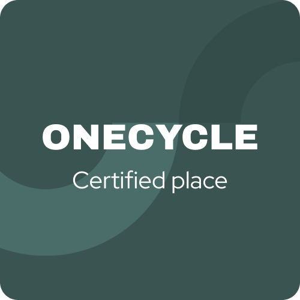
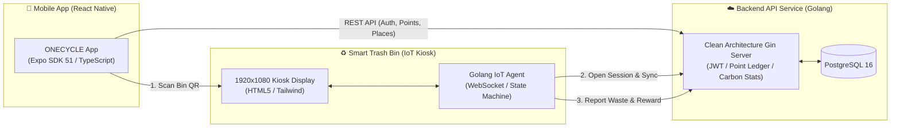

<div align="center">
  
  <h1>EcoCycling (ONECYCLE)</h1>
  <p><strong>지속 가능한 미래를 위한 비전 AI 기반 스마트 자원순환 & 친환경 라이프스타일 플랫폼</strong></p>

  <p>
    
    
    
    
    
    
  </p>
</div>

<br/>

## 🌿 Overview
**EcoCycling (ONECYCLE)**은 일상 속 쓰레기 분리배출을 능동적이고 보상 가능한 친환경 행동으로 전환하는 스마트 리사이클링 생태계입니다.  
사용자는 모바일 앱을 통해 주변 친환경 거점을 찾고, 현장의 IoT 스마트 쓰레기통 QR코드를 스캔하여 투입구를 엽니다. 투입된 자원은 실시간 AI 비전 판별 및 계량을 거쳐 사용자 계정에 포인트 원장과 탄소 저감량("자동차 감축 효과", "나무 식수 효과")으로 누적됩니다.

---

## 🏛️ Ecosystem Architecture



---

## 📂 Core Repositories

| Repository | Tech Stack | Role & Key Features | Status |
| :--- | :--- | :--- | :--- |
| **[`Ecocycling-Server-Code`](https://github.com/EcoCycling/Ecocycling-Server-Code)** | Golang 1.24+, Gin, GORM, PostgreSQL | • Clean Architecture 기반 고성능 REST API 백엔드<br>• JWT / OTP 인증, 포인트 원장 트랜잭션<br>• IoT QR 스캔 세션 관리, 탄소 저감량 환산 알고리즘 | `Active` (v1.0.0-dev) |
| **[`Ecocycling-Client`](https://github.com/EcoCycling/Ecocycling-Client)** | React Native, Expo 51, TypeScript, Zustand | • Figma 디자인 토큰 100% 매핑 크로스플랫폼 모바일 앱<br>• 온보딩, 이메일/OTP 인증, 플로팅 QR 스캐너<br>• 포인트 내역 타임라인, 탄소 저감 업적/차트, 거점 탐색 | `Active` (v1.0.0-dev) |
| **[`waste-sorting-system`](https://github.com/EcoCycling/waste-sorting-system)** | HTML5, Tailwind, Golang Kiosk Agent | • 스마트 쓰레기통 1920×1080 풀스크린 디스플레이 UI<br>• Stand-by ➔ QR 스캔 ➔ 투입 ➔ AI 측정 ➔ 완료 5단계 상태 머신<br>• Golang IoT WebSocket 실시간 제어 및 센서 시뮬레이터 | `Active` (v1.0.0-dev) |

---

## 🎨 Design System & Color Tokens
피그마에서 추출된 친환경 브랜드 컬러 팔레트를 전 저장소에 동일하게 적용합니다:

```
■ Primary Forest Green : #3A5451
■ Background Soft Gray : #F2F2F2
■ Deep Charcoal Text   : #2B2B2B
■ Card / Modal Surface : #FFFFFF
■ Muted Secondary Text : #737373
■ Accent / Alert       : #E03838
```

---

## 🔒 Governance & Ownership
- **Project Manager / Implementation Owner**: limmireu1214@gmail.com ([@Mireu-Lab](https://github.com/Mireu-Lab))
- **Branch Strategy**: Strict GitFlow (`main` ➔ `develop` ➔ `feature/*`)
- **Legacy Preservation**: 레거시 프로토타입 코드는 `v0.1.0-legacy-archive` 공식 GitHub Release로 영구 보관 중
